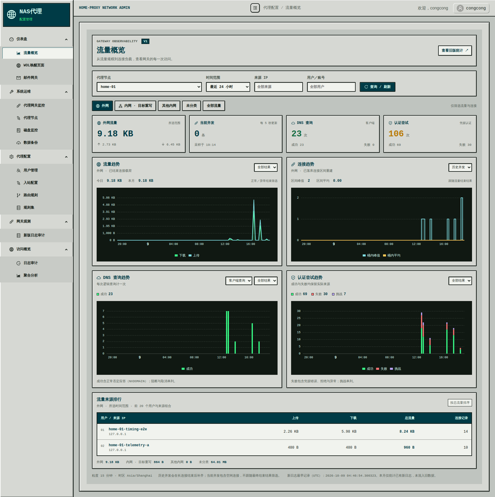
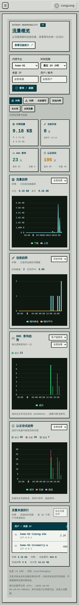

# 流量概览增强预览（C2）

2026-10-09 按用户要求提供可实际查看的第一版。入口：仪表盘 → 流量概览（`/config/dashboard/traffic`）；Dashboard 内嵌使用同一个组件。用户可在页面右上角查看旧版统计并返回新版。后续其他统计消费者的迁移仍按各自批次处理。

## 数据与统计口径

| 功能 | 来源 | 口径 |
| --- | --- | --- |
| 今日／本月／区间上传下载、来源排行 | `telemetry.proxy_session_log_v1 FINAL` | 一条唯一连接的最终成功转发载荷；按 `occurred_at = ended_at` 入账 |
| 历史并发、平均、峰值 | 同一连接汇总表 | 已建立连接的 `[connected_at, ended_at)` 与查询窗口相交；扫描同时起止的合并增量，峰值不把相邻连接误计为同时存在 |
| 当前并发 | Worker 新心跳 `metrics.establishedConnectionsV1`，现有 MySQL `worker_status.metrics_json` | 通道建立后登记，入站关闭即移除；一个代理连接计一次，空闲连接仍在计数；每 5 秒查询最近采样 |
| DNS 次数 | `telemetry.dns_query_log_v1 FINAL` | 一次逻辑查询计一次，默认 CLIENT，可选 PROXY_RESOLVE 或全部 |
| 认证次数 | `telemetry.credential_auth_log_v1 FINAL` | 一次认证尝试计一次，不以连接／用户去重 |

业务分类使用日志快照中的 EXTERNAL／INTERNAL_REWRITE／OTHER_INTERNAL／UNKNOWN，默认 EXTERNAL。切换分类仅影响流量、连接、历史／当前并发，不能用内外网类别过滤没有目标的 DNS 或认证事实。全部分类的流量守恒；来源排行下方保留其他内网和未知总量。

各查询共用 Worker、时间、来源 IP 与账号；账号为精确匹配，流量／连接／DNS 使用已识别用户名，认证还匹配 attempted／verified username。账号筛选不伪造失败连接的已认证身份。今日／本月使用浏览器提交的 IANA 时区，查询 UTC 时间统一 `[from,to)`；今日／本月跟随来源、分类与结束结果，不随趋势的自定义窗口变成其他日期。

历史并发按区间重叠查询，不能按“在窗口内结束”筛选，也不能只读取审计分页。它仅包含已经落库的结束汇总：尚未关闭、缺失结束汇总或尚未送达的连接不能据此复原，因此近期值会在长连接结束后补齐。它不是 NIC 吞吐或所有网络活动的完整计量。

当前并发与历史统计独立。实时值不跟随最终结束结果；旧 Worker 不支持、采样超过 15 秒或未来超过 10 秒时显示不可用。心跳最多保留 200 个用户／来源／入站分组，分类总数仍覆盖所有当前连接；分组截断时带来源筛选的实时查询显示不可用，不能将部分分组之和显示为完整计数。心跳遍历是采样，不承诺所有 EventLoop 的原子瞬时快照。

## 结果筛选

- 流量：成功是 NORMAL_END，失败是 ERROR_END；全部还保留其他结束状态。历史并发跟随此筛选，且始终要求通道曾建立。
- 建连次数：CONNECTED → SUCCESS、FAILED → FAILURE，BLOCKED／CANCELLED／UNKNOWN 单列。次数按结束汇总归属，未结束的尝试不伪造为完成记录。并发模式不显示失败并发，可切换到建连次数查看失败。
- DNS：ERROR 或客户端应答发送失败为 FAILURE；正常 ANSWERED 且客户端应答已发送（内部解析不要求发送）为 SUCCESS。正常的 NXDOMAIN 属于协议否定应答，不等于网关服务故障；阻断、取消、未知独立显示。
- 认证：SUCCESS 为成功；FAILURE／DENIED／MALFORMED／ERROR 为失败；CHALLENGE、CANCELLED、未知单列。匿名／设备 IP 识别不计为凭据认证。

## API 与呈现

新增独立 `GET /api/observability/v1/overview` 和 `/overview/live`。请求模型见 `OverviewQuery`／前端 `types/overview.ts`，最多查询 31 天，最少 1 分钟；趋势根据窗口自动选择粒度。历史并发最多返回 100,000 个合并时间点，超限时提示缩短范围，不截断成不完整结果。

聚合直接读取去重事实，不从审计页求和，不混合新旧表。UInt64 流量、计数、用户 ID 保持十进制字符串；图表位置转换为近似数值，悬浮提示保留原始字节串。来源排行限制前 20 个组合，区间总量来自完整聚合而非排行之和。历史覆盖注明该节点最早新记录（UTC），本月不填充新模型启用前的数据。首次记录不能证明其后没有采集缺口。

四个 ECharts 面板采用独立单位及共同时间轴：流量上传／下载独立折线与面积、历史并发阶梯线、DNS／认证按结果堆叠柱图。上传／下载共用从零开始的字节轴，曲线高度分别表示各自流量，不能堆叠为下载与总流量，否则上传较小时两条线会误呈贴合。提供节点、时间预设／自定义、来源、账号、各面板结果及内外网切换。桌面双列、手机单列；当前值更新不重播趋势动画。空查询显示空状态，查询故障显示错误及未知数值，不显示伪造零值。

2026-10-09 按视觉反馈统一为现有复古终端主题：复用 `retro-noc.css` 的灰色面板、深青色标题、等宽字体、方形边框与凸起效果；图表使用深色屏幕背景和高对比度系列色，坐标轴、方形图例、提示框及筛选控件同步调整。标题图标复用现有 Ant Design 线框图标，四种图表的布局、统计口径和交互保持原设计。

## 验证

2026-10-10 核对 `192.168.10.85:18081` 的真实外网数据：固定 24 小时窗口的 API 总量、趋势逐桶求和与 ClickHouse 最终事实一致（上传 308,179,268 B、下载 3,153,402,204 B；较早查询会随延迟落库补齐）。浏览器确认旧上传线使用 `stack=bytes`，某桶下载 327,306,704 B、上传 366,851 B，却将上传线画在 327,673,555 B；移除堆叠后分别绘制原始值。修复仅调整前端上传／下载系列，新增不等流量回归用例，流量概览 5 项测试与 `make frontend-build` 通过（构建保留其他页面已有告警）。此记录仅包含只读服务器核验和浏览器临时预览，未部署服务器。

- `make package`：前后端打包及静态同步通过。前端保留原有 MailGateway／UserManagement lint 和依赖版本提示，本次页面没有新增 lint 告警。
- 后端相关单测 29 项通过：窗口边界、并发峰值及按时长加权的平均值、重复生命周期回调、大整数、分类隔离、未认证账号、过期／截断快照、节点列表解析 Instant、原有 Worker 心跳行为、查询不可用返回 503。
- 前端 39 项相关测试通过，覆盖默认外网、来源与独立结果参数、过期响应不覆盖新节点、失败查询不混入旧源、旧版回退。同步回归新版审计及导航。
- `gateway-observability-overview-e2e.py`：只读核对保留 ClickHouse 事实；四类流量守恒，趋势与完整区间一致，DNS／认证结果计数一致，业务分类不会过滤它们，尝试账号失败可查。
- `gateway-observability-overview-live-e2e.py`：真实 SOCKS5 流量，保持两条外网和一条内网重写连接，心跳分别为 2／1、合计 3；空闲仍计数，认证失败不增加，关闭递减，最终日志重建峰值至少 3。只使用既有夹具，保留新增事实，释放本次临时地址及 socket。
- `gateway-observability-overview-browser.cjs`：真实 API 无拦截，检查四图、外网默认、独立结果与账号筛选、手机溢出、旧版返回；无浏览器异常。
- 主题调整后重新完成前端构建、静态同步及控制端打包；新版／旧版概览 5 项测试通过。仅更新本地控制端，重新执行真实浏览器检查并核对外网、内网、失败筛选和手机截图，无浏览器异常或手机横向溢出。下方截图已更新为统一主题后的版本。

本地真实样本 DNS 失败可能为 0，并不注入假记录装饰图形。真实截图：

## 本地预览与回退

预览运行在现有本地控制端 `https://127.0.0.1:18443`，保留原运行环境和数据卷，Worker `home-01` 更新以提供实时分类计数。默认选启用的 default 节点；没有启用的 default 时选首个启用节点。

页面右上角“查看旧版统计”调用原来的日／月／趋势接口，不自动混合数据。旧采集、旧表、原 API、其他旧表消费者均保留。

本地完整镜像回退标签为 `home-proxy-control-manager:before-traffic-overview` 与 `home-proxy-worker:before-traffic-overview`。恢复两者时先恢复 Worker 再恢复控制端，沿用部署时的 Compose 环境覆盖和现有数据卷；不运行 down -v。修改了 Worker 心跳 DTO，因此完整运行时回退应恢复同一批次的两个镜像。页面回退入口只切换查询消费者。
